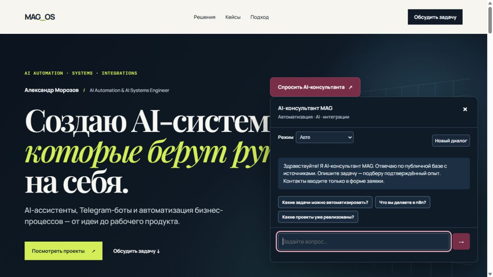
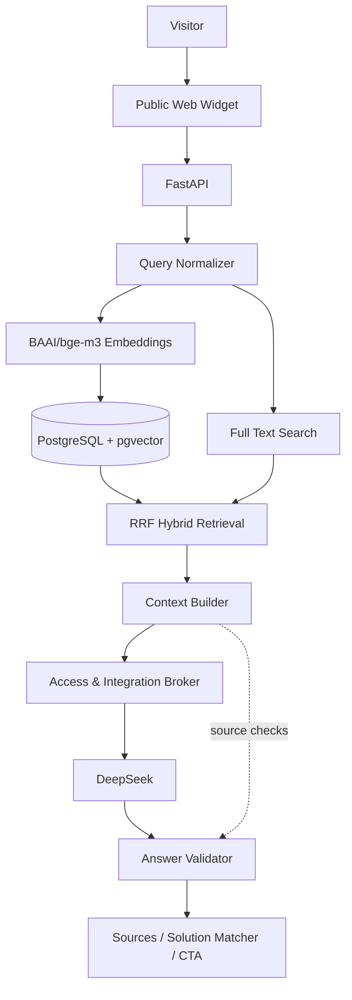
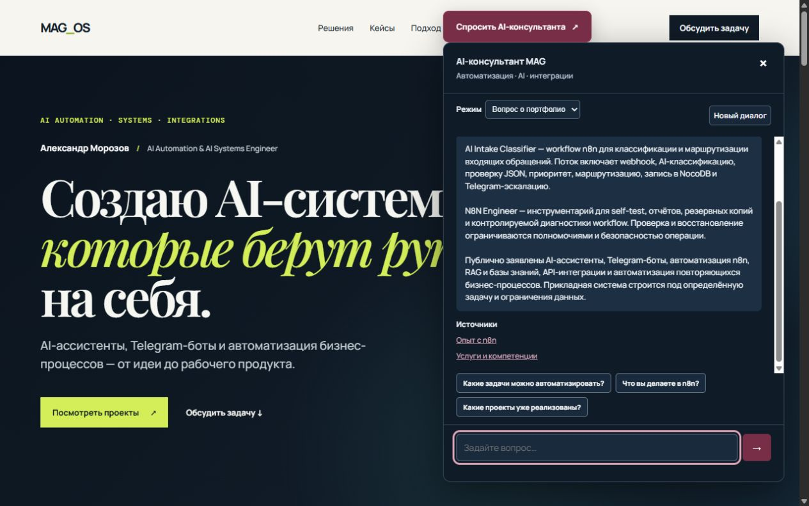
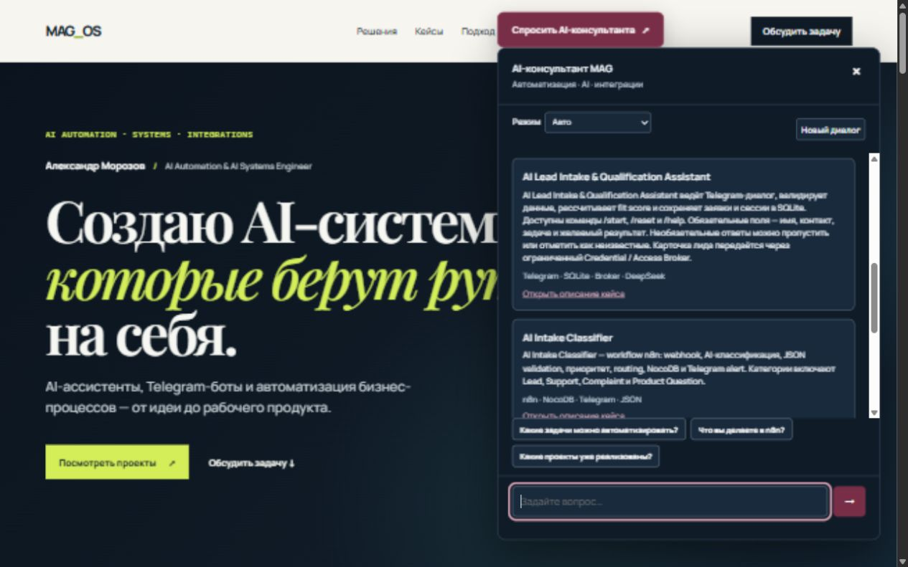
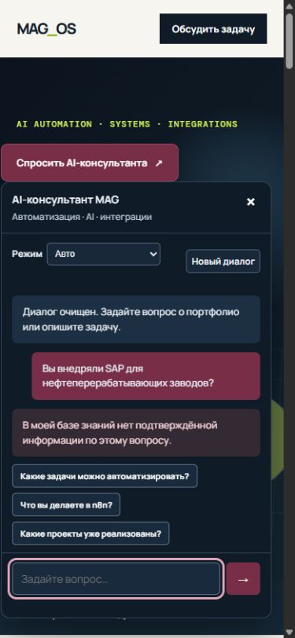
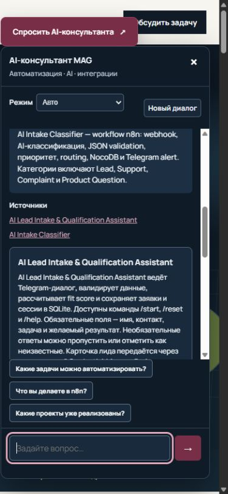

<div align="center">

# AI Automation & Portfolio Consultant

**RAG-консультант по AI-автоматизации и реализованным кейсам:
проверяемые ответы, источники и подбор похожих решений.**

[](https://github.com/malexandro174-tech/ai-automation-portfolio-consultant/releases/tag/v1.0.0)
[](https://www.python.org/)
[](https://fastapi.tiangolo.com/)
[](https://www.postgresql.org/)
[](https://github.com/pgvector/pgvector)
[](https://huggingface.co/BAAI/bge-m3)
[](https://api-docs.deepseek.com/)
[](docs/architecture.md)
[](docs/testing.md)
[](LICENSE)

**[PUBLIC DEMO → ai.mag-astro.ru](https://ai.mag-astro.ru/)** · **Production / Public RAG v2** · **[Последний release: v1.0.0](https://github.com/malexandro174-tech/ai-automation-portfolio-consultant/releases/tag/v1.0.0)**

</div>



> **Проблема.** У посетителя есть бизнес-задача, но ему трудно быстро понять, есть ли релевантный опыт: какие технологии использовались, какой проект похож и чем подтверждается ответ.
>
> **Решение.** Посетитель задаёт вопрос или описывает процесс. Консультант находит проверяемые материалы, показывает источники и до трёх похожих кейсов, уточняет ограничения и предлагает обсудить задачу через существующую форму.

```text
User question → RAG retrieval → Grounded context → DeepSeek
→ Validated answer → Sources → Relevant portfolio cases → Optional CTA
```

Это узкий публичный помощник по портфолио. Он не заменяет обследование процесса и не обещает готовую интеграцию, стоимость или срок без evidence.

## Возможности

### Grounded RAG

- Фактический ответ строится из подтверждённой базы знаний текущего запроса.
- Vector + lexical retrieval объединяются через RRF.
- Каждая выбранная цитата проверяется по source text; ссылки открывают конкретный документ.

### Solution Matcher

- Описание задачи сопоставляется с подтверждёнными portfolio cases.
- До трёх карточек: название, объяснение релевантности, технологии и source link.
- Уточняющие вопросы и architecture direction отделены от фактов реализованного проекта.

### Portfolio Intelligence

Реализованные AI-системы, технологии, API-интеграции и архитектурные подходы. Общее совпадение технологий не превращается в утверждение о конкретном клиенте или внедрении.

### Safety

Honest fallback при отсутствии evidence; недоверенные ввод и документы; Broker-only LLM access без raw credentials в приложении. Чат не отправляет заявки автоматически.

### Conversation

Bounded session memory, follow-up и Новый диалог. Память помогает новому поиску, но не подтверждает факты самостоятельно.

## Сценарии использования

| Ситуация | Что получает посетитель |
|---|---|
| Нужно понять опыт специалиста | Краткий ответ о системах и открываемые источники |
| Интересуют n8n или API | Подтверждённые кейсы и технологические ограничения |
| Есть задача обработки Telegram-заявок | Похожие проекты, причины выбора и уточнения |
| Важно проверить безопасность | Публичное объяснение контролируемых интеграций |
| Запрошен неподтверждённый опыт | Fallback вместо выдуманного внедрения |

## Архитектура



Production использует существующий FastAPI process и существующий BGE/TEI. Новый компонент — dedicated pgvector DB во внутренней сети. Отдельный RAG app container и новая resident model не понадобились. Shared database других сервисов не используется как vector store.

Детали: [architecture](docs/architecture.md) · [контракты API](docs/api.md) · [публичный prompt overview](SYSTEM_PROMPT_PUBLIC.md).

## Источники — часть ответа

Каждый factual answer должен иметь подтверждающий source. Модель выбирает цитаты из retrieved context; сервер проверяет chunk identifiers и дословность цитат. Если проверка не проходит, возвращается fallback, а неподтверждённый текст не выдаётся как ответ.



Примеры source pages: [опыт n8n](https://ai.mag-astro.ru/knowledge/tech-n8n) · [Lead Intake](https://ai.mag-astro.ru/knowledge/case-lead-intake) · [API и Broker security](https://ai.mag-astro.ru/knowledge/tech-security-broker).

## Solution Matcher: пример

Синтетический запрос, без реальных leads:

> Нужно собирать заявки из Telegram, квалифицировать AI и передавать менеджеру.

| Релевантный кейс | Почему он подходит |
|---|---|
| [AI Lead Intake & Qualification Assistant](knowledge/public/case-lead-intake.md) | Telegram-диалог, валидация данных, fit score и структурированная заявка |
| [AI Intake Classifier](knowledge/public/case-intake-classifier.md) | Классификация, JSON validation, приоритет, routing и эскалация |

Далее консультант уточняет входные каналы, ожидаемый результат и систему назначения. Это предложение обсудить направление решения, а не обещание уже реализованной интеграции для нового заказчика. CTA переводит к существующей форме; `auto_send=false`.



## База знаний

**25 public-safe Markdown documents**: один документ — одна тема. Категории: `faq`, `portfolio`, `process`, `profile`, `security`, `services`, `technology`.

Metadata включает `doc_id`, `title`, `category`, `source_type`, `source_url`, `version`, `updated_at`, `confidentiality`, `public_safe`, tags и technologies. Portfolio документы дополнительно содержат `case_id`. Manifest фиксирует content hashes.

Материалы проверяются на секреты, private infrastructure и PII. Реальные клиентские переписки и leads не входят в корпус. Исторический кейс не означает, что его runtime сейчас запущен.

Приёмка проведена на production corpus **1.0.1**. Публичная копия **1.0.2** уточняет историческую формулировку двух документов о FAQ v1 и убирает внутреннюю историю разработки; production KB этой публикацией не менялась. [Knowledge overview](docs/knowledge-base.md) · [25 документов](knowledge/public) · [manifest](knowledge/MANIFEST.json).

## Результаты приёмки

Измерения production от **2 октября 2026**; повторный локальный regression публичного исходного кода — **3 октября 2026**. Production tests ради GitHub-публикации не перезапускались.

| Проверка | Подтверждённый результат |
|---|---|
| Knowledge documents / active chunks | 25 / 25 |
| Frozen holdout | 19/20 = 95% |
| Factual questions | 10/10 = 100% |
| Source support | 20/20 = 100% |
| Critical hallucinations | 0 в наборе |
| Public latency | P95 5,50 с; max 6,12 с — 20 uncached запросов |
| App rollback к FAQ v1 | 3,83 с |
| Full app / proxy / symlink rollback | 3,77 с; public v2 затем восстановлен |
| Injection / resource admission | PASS в проверенных сценариях |
| Локальные tests публичного кода | 69 passed, без production подключений |

> Небольшой synthetic/frozen holdout не доказывает accuracy всей будущей аудитории. Один ambiguous query не получил ожидаемого уточнения и не зачтён. Польза для реальных посетителей и бизнес-эффект пока не измерены.

[Методика и локальные проверки](docs/testing.md) · [обезличенные production results](docs/evidence/production-acceptance.json).

## Live Demo

[Открыть ai.mag-astro.ru](https://ai.mag-astro.ru/) → «Спросить AI-консультанта».

1. Какие AI-системы и проекты уже реализованы?
2. Есть ли опыт n8n/API?
3. Есть похожий Telegram lead qualification кейс?
4. Как защищаются API-ключи?
5. Есть ли опыт SAP для нефтепереработки? — пример honest fallback.

В той же сессии после подбора: «А как этот кейс был устроен технически?» Затем показать Новый диалог. Контакты вводятся только в отдельной форме, не в чат.

<details>
<summary>Fallback и мобильный интерфейс</summary>





</details>

## Технологический стек

| Component | Role |
|---|---|
| FastAPI / Python | API и существующий runtime |
| PostgreSQL 17 / pgvector 0.8.2 | Dedicated database, vector storage и HNSW |
| BAAI/bge-m3 | Embeddings, 1024 dimensions, existing TEI |
| PostgreSQL FTS | Lexical retrieval |
| RRF | Объединение retrieval ranks |
| DeepSeek | Answer generation; observed model `deepseek-flash` |
| Access & Integration Broker | Контролируемый LLM access |
| Docker / Compose | Ограниченное deployment placement |
| Nginx | HTTPS и reverse proxy |
| HTML / CSS / JavaScript | Public widget, sources, matcher и reset |

## Безопасность

- Только scoped `CHAT_COMPLETION`; приложение не читает raw provider credentials.
- Request validation: Origin, body, message, session ID и mode.
- Rate limit, одна активная RAG-операция и bounded sessions.
- Prompt injection isolation и exact source validation; проверенный fallback.
- Анонимные timings/usage вместо полных диалогов в логах.
- DB internal only; отдельные reader и telemetry роли, без admin credentials в app.
- Нет automatic lead submission и реальных платежей из чата.

[Security boundaries](docs/security.md). Private policy, host addresses, dumps и operational recovery data не входят в репозиторий.

## Quick Start

### A. Public demo

Для проверки продукта установка не нужна: [открыть public assistant](https://ai.mag-astro.ru/).

### B. Architecture overview

Начать с [architecture](docs/architecture.md), [API](docs/api.md) и [system prompt overview](SYSTEM_PROMPT_PUBLIC.md).

### C. Local development prerequisites

Python 3.12+; команды ниже устанавливают публичный package и запускают offline regression:

```bash
git clone https://github.com/malexandro174-tech/ai-automation-portfolio-consultant.git
cd ai-automation-portfolio-consultant
python -m venv .venv
# Activate .venv for your shell
python -m pip install -e ".[test]"
python -m pytest -q
```

**Это не готовая standalone distribution.** Полный live pipeline требует совместимого Broker, pinned TEI, populated dedicated pgvector DB, разделённых ролей и host app/proxy integration. Они не создаются командами выше. Private Mag_OS Broker и production configuration не распространяются. [Integration prerequisites](docs/development.md) описывают границы без внутренних адресов и secrets.

## Структура проекта

```text
src/portfolio_rag/       # RAG logic, configurable adapters, public API integration
knowledge/public/       # 25 Markdown documents
knowledge/MANIFEST.json # Publication corpus versions and hashes
schema/                 # Non-destructive schema definition; no roles/secrets/data
web/                    # Actual consultant widget fragment, CSS and JS
tests/                  # Offline public regression suite
docs/                   # Architecture, API, testing, security, economics and images
SYSTEM_PROMPT_PUBLIC.md # Public explanation of answer rules
```

Публичный исходный код сохраняет retrieval, validator, memory и service logic. Private addresses заменены connection settings; operator admission инструменты исключены. Это publication variant, а не экспорт production deployment или изменение сайта.

## Экономика

На 20 измеренных запросах: в среднем **1789 input / 116,45 output tokens**. Shared BGE compute не считается бесплатным; стоимость инфраструктуры и поддержки — отдельные явные допущения. [Economics summary](docs/economics.md) содержит сценарии 500 / 3000 / 10000 запросов. Это forecast, не invoice и не измеренный ROI.

## Ограничения

- Production concurrency ограничена одной активной RAG-операцией.
- Usefulness business pilot пока не проведён.
- Один ambiguous-query UX gap обнаружен в frozen holdout.
- Доступность и изменения внешнего provider влияют на ответ и latency.
- Knowledge base требует периодического review; исторический опыт не равен текущей доступности сервиса.
- Source support проверяет доказательство ответа, но не гарантирует полезность каждого нового ответа.

## Roadmap

Real visitor usefulness pilot; уточнение ambiguous queries на новом holdout; расширение и review portfolio knowledge; privacy-aware query analytics; lead intelligence; Commercial Director integration; managed standalone deployment после обследования. Это будущие направления, не функции текущего release.

## Документация и release

[Architecture](docs/architecture.md) · [Knowledge base](docs/knowledge-base.md) · [Testing](docs/testing.md) · [Security](docs/security.md) · [Economics](docs/economics.md) · [v1.0.0 release](https://github.com/malexandro174-tech/ai-automation-portfolio-consultant/releases/tag/v1.0.0).

Автор: Александр Морозов / [malexandro174-tech](https://github.com/malexandro174-tech). Public demo: [ai.mag-astro.ru](https://ai.mag-astro.ru/). License: [MIT](LICENSE).
