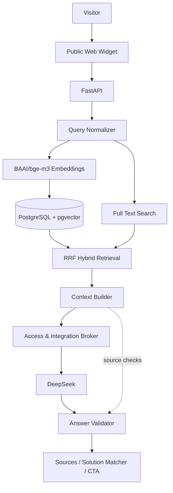

# Architecture

Query Normalizer очищает ввод и для follow-up добавляет предыдущий пользовательский вопрос. BGE формирует embedding; vector cosine search и PostgreSQL full-text search возвращают кандидатов. RRF объединяет ranks, context builder ограничивает размер и число кейсов. Broker выполняет DeepSeek completion; сервер проверяет exact quotes и sources до выдачи ответа.

Параметры принятой реализации: threshold 0.50, candidate_k 12, final_k 4, matcher_k 6, RRF k 60, context budget 2200 BGE tokens. BGE-M3 dimension 1024; model revision фиксируется, silent truncation запрещена. Session TTL 1800 с, максимум 512 sessions, шесть entries по 800 символов.

Placement: существующий FastAPI process, existing BGE/TEI и отдельная DB. App budget 256 MiB, DB budget 192 MiB; concurrency 1. Реальный admission учитывал доступную память после app/DB peaks, swap trend, memory pressure, OOM counters и здоровье Core. Это ограниченный измеренный scope, не обещание для будущей произвольной нагрузки.

В публичной source variant connection settings задаёт владелец отдельного deployment. Host-specific addresses, private Broker policy и operator admission endpoints исключены. Schema содержит структуры, не credentials, roles или production data. Production ingestion и provisioning не выполняются из Quick Start.
